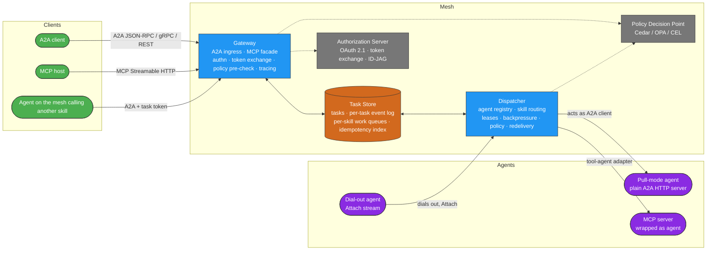
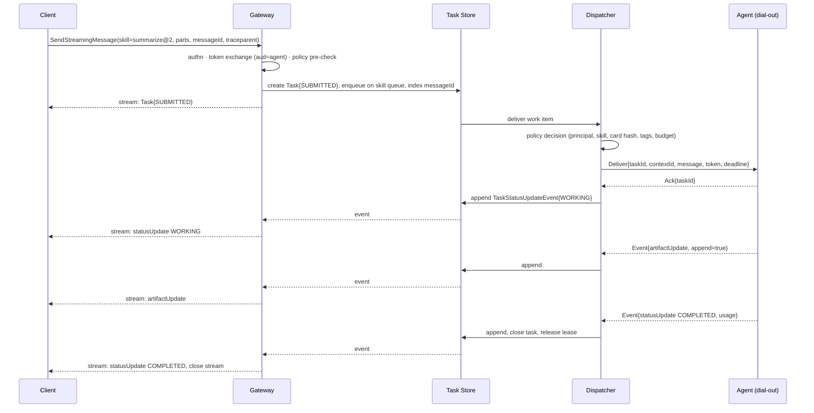

# Agenet v2 — Architecture

## Components

### Gateway (ingress)

- Terminates client traffic in all three A2A bindings and, optionally, MCP (see [06](06-mcp-bridge.md)).
- Serves Agent Cards: one **mesh card** at `/.well-known/agent-card.json` listing every skill the
  caller is allowed to see, and one **virtual card per agent** at
  `/agents/{agent}/.well-known/agent-card.json`. A client that only speaks A2A can treat each
  virtual endpoint as an ordinary remote agent and never learn the mesh exists.
- Authenticates the caller (OAuth 2.1 resource server), exchanges the caller's token for a
  task-scoped internal token whose audience is the target agent, and attaches the delegation chain.
- Resolves the routing key (`agenet.io/skill`, or the virtual endpoint's agent), runs a policy
  pre-check on cheap attributes, assigns `taskId` and `contextId`, writes the task, and enqueues.
- Serves `GetTask`, `ListTasks`, `SubscribeToTask`, `CancelTask`, and push-notification config
  directly from the task store. No Gateway replica holds state; any replica can serve any request.
- Opens the OTel `invoke_agent` CLIENT span and records the policy decision on it.

### Task Store

The replacement for v1's request channel and response-UUID channel. The spec defines its
semantics, not its implementation (NATS JetStream, Kafka, Postgres, and Redis Streams all fit).

- **Task record**: the A2A `Task` (`id`, `contextId`, `status`, `artifacts`, `history`) plus
  Agenet delivery metadata (lease, attempt count, deadline, budget, routing key, agent card hash).
- **Event log per task**: append-only, ordered, retained until terminal state + TTL. Every
  `TaskStatusUpdateEvent` and `TaskArtifactUpdateEvent` is an entry. `SubscribeToTask` replays
  from an offset, which is how a client resumes a dropped stream.
- **Work queue per routing key**: at-least-once delivery to Dispatchers; a message is
  acknowledged only after an agent has acknowledged delivery.
- **Idempotency index**: `(tenant, messageId)` → `taskId`, retained for the dedupe window.
- **Context index**: `contextId` → task ids, for `ListTasks` and affinity hints.

### Dispatcher (egress)

- Accepts outbound `Attach` streams from agents, validates the Agent Card signature, pins the
  card hash, and records the instance with its declared capacity.
- Acts as an A2A *client* toward pull-mode agents that are reachable by URL, so existing A2A
  servers join without an SDK.
- Consumes work queues for the skills it has instances for, calls the policy decision point
  with full attributes, selects an instance (least-loaded, with optional `contextId` affinity),
  and delivers. Tracks leases and heartbeats; redelivers on ack timeout or instance loss when
  the task is still redeliverable (see [03](03-task-lifecycle.md)).
- Forwards agent events to the task store, rolls usage into the task, and forwards cancel and
  follow-up input to the owning instance.

### Agent

Any A2A 1.0 server. Three attachment modes:

| Mode | How it joins | When to use |
|---|---|---|
| Dial-out | Opens `Attach` to a Dispatcher with its signed card | Behind NAT, on a laptop, at the edge, or whenever inbound ports are unwanted |
| Pull | Registered by URL; Dispatcher calls it as an A2A client | Existing A2A agents, cloud-hosted agents |
| Tool agent | An MCP server wrapped by the adapter in [06](06-mcp-bridge.md) | Expose tools and data sources as skills |

## Primary flow: send a message, stream the result

If the client's stream drops after step 5, the task keeps running. The client calls
`SubscribeToTask(taskId)` on any Gateway replica and receives the log from the beginning or
from the last offset it saw.

## Pause flow: agent needs input

1. Agent emits `TaskStatusUpdateEvent{INPUT_REQUIRED, message: question}`.
2. Dispatcher appends it, keeps the lease but marks the task parked; Gateway forwards and ends
   the client's stream (A2A semantics: an interrupted state closes the stream).
3. Client sends `SendMessage` with the same `taskId` and `contextId`.
4. Gateway validates the task is parked, appends the message to history, and routes it to the
   owning instance as `Input{taskId, message}`. If that instance is gone, the task is
   redelivered to another instance of the same skill with full history, provided the agent card
   declares `agenet.io/resumable: true`; otherwise the task transitions to `FAILED` with reason
   `OWNER_LOST`.
5. Agent continues, emitting `WORKING` then a terminal state.

The same path serves `AUTH_REQUIRED` (agent needs the user to grant a credential) and a policy
decision of `require_approval`, which the Dispatcher surfaces as `INPUT_REQUIRED` with a
structured approval request in the status message.

## Agent-to-agent flow inside the mesh

An agent that needs another skill calls the Gateway like any client, presenting the task token
it received. The Gateway exchanges that token for a new one with the next agent as audience,
appends the agent to the delegation chain, decrements the hop budget, and creates a child task
whose `contextId` equals the parent's and whose message carries `referenceTaskIds=[parentTaskId]`.
Cancelling the parent cancels children. Usage rolls up through `contextId`.

## Deployment shapes

- **Single binary**: Gateway, Dispatcher, and an embedded task store in one process for
  development and small installs.
- **Scaled**: N stateless Gateway replicas behind any L7 balancer; M Dispatchers partitioned by
  skill or tenant; a replicated log (JetStream, Kafka) as the task store.
- **Federated**: a Dispatcher in one mesh registers as a pull-mode agent in another, re-exporting
  a filtered set of skills. Delegation chains and trace context cross the boundary unchanged.
