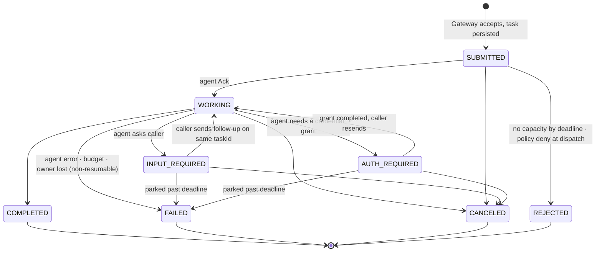

# Agenet v2 — Task lifecycle

Agenet uses A2A's `TaskState` unchanged and adds delivery sub-states that are visible in the
task record but never leak into `TaskState`.

## States

Delivery sub-states on the task record: `queued` (in a work queue, no lease),
`leased` (sent to an instance, awaiting `Ack`), `acked` (lease active), `parked`
(interrupted state, lease held or released), `terminal`.

## Guarantees

| Property | Rule |
|---|---|
| Durability | A task is persisted before the Gateway returns `SUBMITTED`. An accepted task is never lost by a Gateway, Dispatcher, or agent crash. |
| Ordering | Events for one task are totally ordered by the task store's log offset. Producer `seq` is scoped to `(taskId, attempt)` and is only used for producer-side deduplication. No ordering across tasks. |
| Delivery to agents | At-least-once, gated by a committed lease. Redelivery is unconditional only while the task store holds **no committed lease** for the attempt: `Ack` timeout, `Reject`, or instance loss before the Dispatcher persisted the `Ack`. Once the lease is committed the Dispatcher sends `Started`; non-idempotent skills begin side effects only after `Started`, so a failure before `Started` is always safe to redeliver. After a committed lease, redelivery requires the skill to be `idempotent` or the task `resumable`; otherwise the task fails with `OWNER_LOST`. The window between the agent's `Ack` and the commit is therefore the only ambiguity, and it is closed by the agent not acting until `Started`. |
| Delivery to clients | At-least-once via `SubscribeToTask` replay; exactly-once observed by deduping on `(taskId, offset)`. |
| Idempotency | `(tenant, messageId)` is unique for the dedupe window (default 24 h). A repeat with an identical payload returns the existing task; a repeat with a different payload is `IDEMPOTENCY_CONFLICT`. Durable-execution engines (Temporal, Restate, Inngest) retry freely. |
| Deadlines | `agenet.io/deadlineMs` is absolute from acceptance. Expiry cancels with reason `DEADLINE_EXCEEDED`; parked tasks fail instead. |
| Budgets | Usage is summed per task and per `contextId`. Exceeding any budget dimension fails the task and denies new child tasks in that context. |
| Retention | Event log kept for `retentionAfterTerminal` (default 7 d), task record for `taskRetention` (default 30 d), both per tenant. |

## Streaming and resumption

- `SendStreamingMessage` and `SubscribeToTask` return A2A `StreamResponse` events read from the
  log. Each event carries `metadata["agenet.io/offset"]`, the task-global log offset assigned
  by the task store. A client resumes a **non-terminal** task with `SubscribeToTask` plus
  `metadata["agenet.io/afterOffset"]`.
- Recovery order after a dropped stream is `GetTask` first, then `SubscribeToTask` only if the
  snapshot is non-terminal. Per A2A, `SubscribeToTask` on a terminal task returns
  `UnsupportedOperationError`; the snapshot already holds the final status, artifacts, and
  history. Clients that negotiate `https://agenet.io/ext/replay/v1` may additionally read a
  terminal task's full event log with `ListTaskEvents(taskId, afterOffset)`.
- Artifact chunks use A2A's `append` and `lastChunk`; the Gateway never buffers or reorders.
- Stream close after a terminal event means done. Stream close by the client is **not**
  cancellation (it is in MCP, but A2A separates the two); use `CancelTask`.

## Cancellation

1. `CancelTask` marks the task `cancel_requested` and appends a status event with
   `metadata["agenet.io/cancelRequested"]=true` so subscribers see it immediately.
2. Dispatcher sends `Cancel` to the owning instance. The agent emits `CANCELED` when it has
   stopped side effects.
3. If no `CANCELED` arrives within `cancelGrace` (default 30 s) the Dispatcher force-transitions
   the task to `CANCELED` with reason `FORCED` and releases the lease. The agent's later events
   are rejected with `FAILED_PRECONDITION`.
4. Cancelling a parent cancels every child task in the same `contextId` whose
   `referenceTaskIds` include the parent.

## Pause: `INPUT_REQUIRED` and `AUTH_REQUIRED`

- The agent's status message carries the question as ordinary parts. For structured
  elicitation, a `data` part with JSON Schema under the part's `metadata["agenet.io/inputSchema"]`
  (`Part` does have `metadata`) lets
  clients render a form; the MCP facade maps this to MRTR.
- Follow-up is a `SendMessage` with the same `taskId`. The Gateway appends to history and
  routes `Input` to the owner, or redelivers with history if the agent is `resumable`.
- Policy `require_approval` uses the same state with a status message whose data part is
  `{ "approval": { "policyId", "reason", "attributes" } }`. Approval is a follow-up from a
  principal allowed by the policy to approve; the Dispatcher then delivers the original message.

## Push notifications

A2A `TaskPushNotificationConfig` is honoured by the Gateway: every status change is POSTed to
the webhook with the task id, signed with an HTTP Message Signature (RFC 9421) keyed by the
mesh, and retried with backoff for 24 h. Webhook hosts must be on the tenant's egress
allowlist.

## Multiple instances and affinity

Routing picks the least-loaded instance with free credits among those whose card hash is
allowed by policy. `contextId` affinity is a hint, not a guarantee: if the previous instance
is healthy and has credits, it is preferred; otherwise any instance is used and `history` is
included in `Deliver`.
